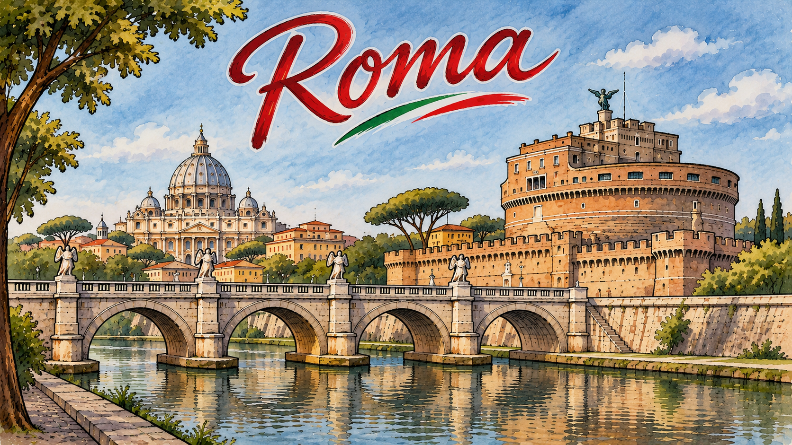

Rím (31.10. - 26.11.2026)
--------------------------

Dovolenka s čiastočným pracovaním z domu v Ríme na jeden mesiac. Tu sú fotky z celého [výletu](https://photos.app.goo.gl/wTdyNJy3t8hM4pDy9).

<link rel="stylesheet" href="{{ "/public/css/photo-gallery.css" | relative_url }}">

## Cimitero monumentale del Verano (2.11.2026)

Cintorín Verano je úplne niečo iné, než sme zvyknutí u nás. Stoja tu obrovské budovy — a nie jedna, ale hneď mnoho — určené výhradne na urny. Jednotlivé hrobky sú vždy veľké a bohato vyzdobené, a medzi nimi rastú všade obrovské stromy, ktoré celému miestu dodávajú až monumentálny, takmer parkový charakter.

  
  
  
  
  

Jedinou nevýhodou je, že sa zatvára skoro — prakticky hneď, ako sa začína stmievanie. Vychutnať si teda vysvietený cintorín po tme úplne možné nie je.

## Fontána di Trevi a Španielske schody: prehliadka podzemného akvaduktu (4.11.2026)

Absolvovali sme [Trevi Fountain & Spanish Steps: Underground Aqueduct Tour](https://gyg.me/zvQonp1b) — prehliadku, ktorá spája dve známe turistické miesta s menej očividnou históriou Ríma pod zemou.

Španielske schody (*Scalinata di Trinità dei Monti*) financovala cirkev a Francúzi po tom, čo sa nevedeli dohodnúť so Španielmi. Prečo sa teda volajú „španielske“ vraj nikto poriadne nevie — ide jednoducho o zlý preklad, ktorý sa uchytil. Neďaleko stojí aj *Colonna dell'Immacolata Concezione*: 8. decembra na ňu pápež za pomoci hasičov počas ceremoniálu umiestni veniec, a až potom sa oficiálne môžu začať zdobiť vianočné dekorácie v meste. Pápež žije v Ríme preto, že tu je hrobka svätého Petra; jeho symbolom sú prekrížené kľúče, ktoré vidno úplne všade keď ich človek hľadá.

Zaujímavá zastávka bola aj v obchodnom dome *Rinascente*. Pri jeho rozširovaní pred tromi rokmi našli na nižšom poschodí časti akvaduktu. Mohli celý priestor zavrieť — alebo ho sprístupniť. Zvolili druhé, takže medzi oblečením človek narazí na murivo akvaduktu. Zvonku to však takmer nie je označené a ani sami o tom moc nehovoria: obchody sú drahé a priemerný turista zrejme nie je ich cieľová skupina.

  
  
  
  
  

Akvadukt slúžil predovšetkým verejnosti a kúpeľom — Rimania sa v nich kúpali každý deň — a do súkromných domov voda z neho išla len zriedka a bolo to drahé. Mal dva súbežné tunely, aby sa pri údržbe dala voda presmerovať. Videli sme aj starodávnu prečerpávaciu stanicu, ktorá bola súčasťou ďalšieho paláca v podzemí. Podobne je to s mnohými historickými miestami v Ríme: štát nemá peniaze na ich údržbu, a tak sa o ne starajú súkromníci. Vstupné na prehliadku zahŕňalo aj vstup do paláca — kedysi to bolo kino, no po nájdení zvyškov akvaduktu ho prerobili na turistické miesto. Zdá sa že sa stále využíva na rôzne podujatia, práve tam bola nejaká konferencia.

Keď na Rím v minulosti útočili, často sa ho snažili obkľúčiť a vyhladovať; súčasťou taktiky bolo ničenie akvaduktov. Tento — Aqua Virgo — však nikdy nezničili, a stále je možné piť z verejných pitítok vodu z neho, ktorá je mierne minerálna. Raz ho ale chceli zneužiť na vniknutie do mesta, takže ho Rimania museli čiastočne zničiť sami. Podobné epizódy sa v histórii opakovali a s nimi sa menil aj zdroj vody — a teda aj to, kde ľudia v rámci mesta hlavne žili. Aj preto je centrum Ríma také rozsiahle.

Kúsky akvaduktu sa tiahnu celým mestom a tu a tam sú prístupné, no často je k nim cesta nebezpečná alebo nemožná. A keďže od jeho postavenia pred zhruba dvetisíc rokmi je Rím v priemere už o deväť metrov vyššie, ležia tieto pozostatky prekvapivo hlboko pod dnešnou úrovňou ulíc.

## Anjelský hrad — Castel Sant'Angelo (5.11.2026)

[Castel Sant'Angelo](https://direzionemuseiroma.cultura.gov.it/museo-nazionale-di-castel-santangelo/) je celkom veľká kamenná pevnosť. Obsahuje niekoľko miestností s obrazmi a freskami a hlavne množstvo terás a bastiónov s výhľadmi do všetkých strán — vrátane skvelého záberu na Vatikán. Prehliadka trvá asi dve hodiny: ide sa postupne úplne hore až na najvyššiu terasu a odtiaľ zase dolu cez ďalšie miestnosti, ktoré sme cestou nahor vynechali. Na orientáciu sa hodí [mapa na stiahnutie](https://csamappa.appculture.it/mappe).

Mal som audio guide, ale bolo celkom slabo označené, aké číslo si mám kedy pustiť — pár som ich úplne vynechal, lebo som ich nenašiel. Okrem toho som si uvedomil, že audio guide je všeobecne dosť o ničom: nedá sa porovnať s výkladom človeka, navyše ak nehovorí žiadne zaujímavosti, ale iba suché historické fakty.

  
  
  
  
  

Na záver sa dá pevnosť celá obísť dookola po hradbách a navštíviť bastióny na jej „rohoch“ — čo je trochu nepresné, keďže samotná pevnosť je okrúhla. Väčšina ľudí si to však zjavne nevšimne a rovno zíde dole, takže tadiaľ skoro nikto nejde. Okolo pevnosti aj vo vnútri prebiehali stavebné práce, čo je na jednu stranu dobre, že sa niečo robí, na druhú mierne otravné — klasické „nech to robia, ale nie keď som tu ja“.

