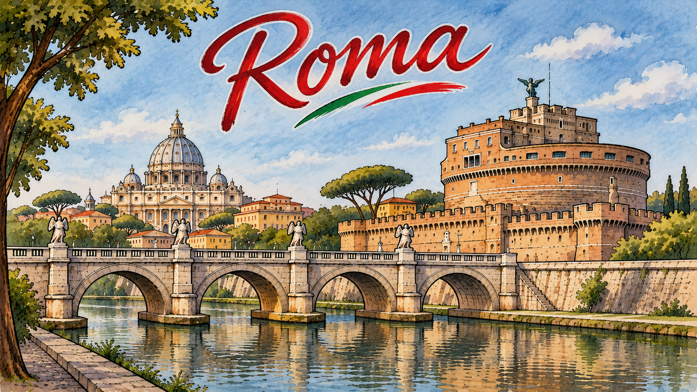

Rím (31.10. - 26.11.2026) {#ubytovanie}
--------------------------

Dovolenka s čiastočným pracovaním z domu v Ríme na jeden mesiac. Tu sú fotky z celého [výletu](https://photos.app.goo.gl/wTdyNJy3t8hM4pDy9).

<link rel="stylesheet" href="https://unpkg.com/leaflet@1.9.4/dist/leaflet.css" integrity="sha256-p4NxAoJBhIIN+hmNHrzRCf9tD/miZyoHS5obTRR9BMY=" crossorigin="">
<link rel="stylesheet" href="{{ "/public/css/visit-map.css" | relative_url }}">
<link rel="stylesheet" href="{{ "/public/css/photo-gallery.css" | relative_url }}">

Mapa miest, ktoré som navštívil — kliknutím vyberiete bod (zoznam priblíži mapu, pin v mape zvýrazní položku v zozname). Do textu článku skočíte cez odkaz **Čítať viac** v bubline.

## Cimitero monumentale del Verano / Verano Cemetery (2.11.2026) {#verano}

Cintorín Verano je úplne niečo iné, než sme zvyknutí u nás. Stoja tu obrovské budovy — a nie jedna, ale hneď mnoho — určené výhradne na urny. Jednotlivé hrobky sú vždy veľké a bohato vyzdobené, a medzi nimi rastú všade obrovské stromy, ktoré celému miestu dodávajú až monumentálny, takmer parkový charakter.

  
  
  
  
  

Jedinou nevýhodou je, že sa zatvára skoro — prakticky hneď, ako sa začína stmievanie. Vychutnať si teda vysvietený cintorín po tme úplne možné nie je.

## Fontana di Trevi a Scalinata di Spagna — Trevi Fountain & Spanish Steps / Španielske schody (4.11.2026) {#trevi-akvadukt}

Absolvoval som [Trevi Fountain & Spanish Steps: Underground Aqueduct Tour](https://gyg.me/zvQonp1b) — prehliadku, ktorá spája dve známe turistické miesta s menej očividnou históriou Ríma pod zemou.

Španielske schody (*Scalinata di Trinità dei Monti*) financovala cirkev a Francúzi po tom, čo sa nevedeli dohodnúť so Španielmi. Prečo sa teda volajú „španielske“ vraj nikto poriadne nevie — ide jednoducho o zlý preklad, ktorý sa uchytil. Neďaleko stojí aj *Colonna dell'Immacolata Concezione*: 8. decembra na ňu pápež za pomoci hasičov počas ceremoniálu umiestni veniec, a až potom sa oficiálne môžu začať zdobiť vianočné dekorácie v meste. Pápež žije v Ríme preto, že tu je hrobka svätého Petra; jeho symbolom sú prekrížené kľúče, ktoré vidno úplne všade keď ich človek hľadá.

Zaujímavá zastávka bola aj v obchodnom dome *Rinascente*. Pri jeho rozširovaní pred tromi rokmi našli na nižšom poschodí časti akvaduktu. Mohli celý priestor zavrieť — alebo ho sprístupniť. Zvolili druhé, takže medzi oblečením človek narazí na murivo akvaduktu. Zvonku to však takmer nie je označené a ani sami o tom moc nehovoria: obchody sú drahé a priemerný turista zrejme nie je ich cieľová skupina.

  
  
  
  
  

Akvadukt slúžil predovšetkým verejnosti a kúpeľom — Rimania sa v nich kúpali každý deň — a do súkromných domov voda z neho išla len zriedka a bolo to drahé. Mal dva súbežné tunely, aby sa pri údržbe dala voda presmerovať. Videli sme aj starodávnu prečerpávaciu stanicu, ktorá bola súčasťou ďalšieho paláca v podzemí. Podobne je to s mnohými historickými miestami v Ríme: štát nemá peniaze na ich údržbu, a tak sa o ne starajú súkromníci. Vstupné na prehliadku zahŕňalo aj vstup do paláca — kedysi to bolo kino, no po nájdení zvyškov akvaduktu ho prerobili na turistické miesto. Zdá sa že sa stále využíva na rôzne podujatia, práve tam bola nejaká konferencia.

Keď na Rím v minulosti útočili, často sa ho snažili obkľúčiť a vyhladovať; súčasťou taktiky bolo ničenie akvaduktov. Tento — Aqua Virgo — však nikdy nezničili, a stále je možné piť z verejných pitítok vodu z neho, ktorá je mierne minerálna. Raz ho ale chceli zneužiť na vniknutie do mesta, takže ho Rimania museli čiastočne zničiť sami. Podobné epizódy sa v histórii opakovali a s nimi sa menil aj zdroj vody — a teda aj to, kde ľudia v rámci mesta hlavne žili. Aj preto je centrum Ríma také rozsiahle.

Kúsky akvaduktu sa tiahnu celým mestom a tu a tam sú prístupné, no často je k nim cesta nebezpečná alebo nemožná. A keďže od jeho postavenia pred zhruba dvetisíc rokmi je Rím v priemere už o deväť metrov vyššie, ležia tieto pozostatky prekvapivo hlboko pod dnešnou úrovňou ulíc.

## Anjelský hrad — Castel Sant'Angelo / Castle of the Holy Angel (5.11.2026) {#castel-santangelo}

[Castel Sant'Angelo](https://direzionemuseiroma.cultura.gov.it/museo-nazionale-di-castel-santangelo/) je celkom veľká kamenná pevnosť. Obsahuje niekoľko miestností s obrazmi a freskami a hlavne množstvo terás a bastiónov s výhľadmi do všetkých strán — vrátane skvelého záberu na Vatikán. Prehliadka trvá asi dve hodiny: ide sa postupne úplne hore až na najvyššiu terasu a odtiaľ zase dolu cez ďalšie miestnosti, ktoré sme cestou nahor vynechali. Na orientáciu sa hodí [mapa na stiahnutie](https://csamappa.appculture.it/mappe).

Mal som audio guide, ale bolo celkom slabo označené, aké číslo si mám kedy pustiť — pár som ich úplne vynechal, lebo som ich nenašiel. Okrem toho som si uvedomil, že audio guide je všeobecne dosť o ničom: nedá sa porovnať s výkladom človeka, navyše ak nehovorí žiadne zaujímavosti, ale iba suché historické fakty.

  
  
  
  
  

Na záver sa dá pevnosť celá obísť dookola po hradbách a navštíviť bastióny na jej „rohoch“ — čo je trochu nepresné, keďže samotná pevnosť je okrúhla. Väčšina ľudí si to však zjavne nevšimne a rovno zíde dole, takže tadiaľ skoro nikto nejde. Okolo pevnosti aj vo vnútri prebiehali stavebné práce, čo je na jednu stranu dobre, že sa niečo robí, na druhú mierne otravné — klasické „nech to robia, ale nie keď som tu ja“.

## Kapitolské múzeá — Musei Capitolini / Capitoline Museums (6.11.2026) {#capitolini}

[Kapitolské múzeá](https://www.museicapitolini.org/) sídlia na námestí *Piazza del Campidoglio* na Kapitolskom pahorku. Tvoria ich tri Michelangelom navrhnuté budovy okolo námestia — *Palazzo dei Conservatori*, *Palazzo Nuovo* a *Palazzo Senatorio* — spojené podzemným tunelom (*Galleria Lapidaria*). Z *Tabularia* pod Palazzo Senatorio je potom výhľad priamo na Rímske fórum.

Dve poschodia plné obrazov a sôch, no ešte viac než zbierky samotné ma zaujali priestory: úžasne vyzdobené, mnohé steny doslova prepchaté maľbami a vstavanými sochami.

  
  
  
  

## Castello Orsini-Odescalchi, Bracciano / Orsini-Odescalchi Castle (7.11.2026) {#bracciano}

Výlet k [Castello Orsini-Odescalchi](https://www.odescalchi.it/) pri jazere Bracciano. Cesta vlakom bola takmer priama od miesta, kde som býval — asi 50 minút, pohodlný a celkom prázdny vlak. S lístkom to bolo horšie: na stanici bolo všetko zavreté a nefunkčné, na nástupišti nefungoval ani Tap&Go terminál. Skúsil som kúpiť cez stránky, ale do odchodu vlaku ostávalo menej než päť minút a už sa to nedalo. Prvých desať minút navyše išiel vlak tunelom bez signálu. Nakoniec som si lístok kúpil o pár zastávok ďalej — a aj tak ma celou cestou nikto neskontroloval.

Na mieste bol vchod do hradu slabo označený; najprv som šiel na úplne opačnú stranu a musel som sa vrátiť po ceste, ktorou chodia aj autá. Aspoň som si hrad a okolie pozrel aj z inej strany.

Prehliadka trvá asi 90 minút. Začína po hradbách a postupne prejde dovnútra, kde sú dve poschodia na seba nadväzujúcich miestností, kde je hlavne nábytok, obrazy, brnenia a zbrane. [Audio guide](https://a.wonnder.com/il_castello_odescalchi_di_bracciano?fromTag=Castello_Odescalchi_di_Bracciano&trackId=GuUwu4bp1y) bol zdarma na stiahnutie a dal sa počúvať priamo v mobile.

Výklad sa točí predovšetkým okolo panovníkov, čo tu žili. Hrad postavili v 15. storočí *Orsiniovci* — jeden z najmocnejších rímskych rodov renesancie, ktorých majetky siahaly od Tyrhénskeho mora až po Abruzzo. V roku 1560 sa Bracciano stalo vojvodstvom; Paolo Giordano I. Orsini, manžel Isabely de’ Medici, hrad prestaval na reprezentatívne sídlo. Koncom 17. storočia Orsiniovci skrachovali a hrad kúpil *Livio Odescalchi*, synovec pápeža Inocenta XI. Odescalchiovci ho vlastnia dodnes.

  
  
  
  
  

Z okolia jazera Bracciano do Ríma skutočne šiel akvadukt — na mape nižšie je dobre vidieť, ako sa *Aqua Traiana* / *Acqua Paola* ťahá okolo jazera (vľavo hore). Cisár Traján v roku 109 dal postaviť *Aqua Traiana*, ktorá zbierala pramene okolo jazera (nie priamo jazernú vodu) a viedla ich do Trastevere a na Gianicolo — vtedy jedinú časť mesta ešte bez tečúcej vody. Po páde ríše sa vedenie postupne rozpadlo; v roku 1612 ho pápež Pavol V. obnovil a rozšíril ako *Acqua Paola*. Pramene a staré kanály na to pritom predal práve Virginio Orsini z Bracciana. Neskôr sa do potrubia púšťala aj samotná voda z jazera, čo zvýšilo objem, ale zhoršilo kvalitu — odtiaľ aj príslovie *„valere quanto l’acqua Paola“* (byť nanič hodný ako Paoloova voda). Monumentálne vyústenie akvaduktu je dodnes fontána *Fontana dell’Acqua Paola* na Gianicole.

## Park akvaduktov — Parco degli Acquedotti / Park of the Aqueducts (8.11.2026) {#acquedotti}

[Rímske akvadukty](https://en.wikipedia.org/wiki/Roman_aqueduct) (*aquae* / *acquedotti*) zásobovali mesto gravitáciou — voda tiekla z prameňov v Latiu a Sabinských vrchoch miernym sklonom, často v podzemných kanáloch a na oblúkoch. V cisárskom období ich bolo do mesta viacero; Wikipedia má dobré mapy celého systému. [Parco degli Acquedotti](https://www.turismoroma.it/en/places/park-aqueducts) na juhovýchode Ríma (súčasť parku Appia Antica) je miesto, kadiaľ do mesta vchádzalo hneď sedem vedení: *Anio Vetus*, *Aqua Marcia*, *Aqua Tepula*, *Aqua Iulia*, *Aqua Claudia*, *Anio Novus* a novoveký *Aqua Felice*. Najvýraznejšie sú mohutné oblúky Claudia (dokončené roku 52 cisárom Claudiom; voda z prameňov v Simbruinských vrchoch) s neskôr nadstavaným *Anio Novus* (voda z rieky Aniene). *Aqua Marcia* (2. storočie pred n. l.) bola jedným z najdlhších a najcenenejších antických vodovodov. Dnes sú antické akvadukty ruinami v otvorenej krajine — mnohé úseky sú pod zemou alebo navrstvené na sebe — a voda nimi do mesta už netečie; výnimkou je práve Felice, ktorý stále slúži na zavlažovanie.

  
  
  

## Villa Borghese a Villa Medici / Borghese & Medici Villas (9.11.2026) {#borghese-medici}

Deň v parku [Villa Borghese](https://www.turismoroma.it/en/places/villa-borghese) — plný menších budov, ktoré dnes slúžia predovšetkým ako múzeá. V pondelok boli mnohé zavreté, ale to nevadilom lebo som sa chcel hlavne prejsť vonku. Bolo totiž pekne a na dlhšiu dobu už nebude.

Cestou som našiel výhľad zhora na Španielske schody a kostol *Trinità dei Monti*. Ten kostol (aj konvent) je francúzsky — jeden z francúzsky hovoriacich kostolov v Ríme, historicky pod patronátom francúzskej koruny. Schody k nemu vedú z *Piazza di Spagna*, kde dole sídlilo španielske veľvyslanectvo pri Svätej stolici; hore je teda „francúzsky“ koniec, dole „španielsky“. Odtiaľto je to už kúsok k Villa Medici, ktorá s parkom Borghese susedí, no vchod na prehliadku je z úplne inej strany.

[Villa Medici](https://villamedici.it/en/) pôvodne prestaval v 16. storočí kardinál Giovanni Ricci, v roku 1576 ju kúpil kardinál Ferdinando de’ Medici a rozšíril ju ako sídlo pre svoju zbierku antických sôch a umenia. Keď sa stal toskánskym veľkovojvodom a odišiel do Florencie, väčšinu zbierok so sebou zobral. Dodnes tvoria jadro zbierok vo florentských múzeách. V Ríme stále niečo zostalo, ako sochy v záhradách, no mnohé z toho, čo dnes v záhradách vidno, sú repliky. V roku 1803 Napoleon získal vilu výmenou za Palazzo Mancini a umiestnil sem *Académie de France à Rome* — Francúzsku akadémiu, založenú už roku 1666.

  
  
  
  
  
  

Z terasy pri vile, ktorú some navštívili v rámci 90 minútovej prehliadky, je skvelý výhľad na celý Rím. Súčasťou komplexu je aj časť záhrady s ubytovaním pre umelcov. Tam sa bežne nedostanete, ale do akadémie sa dá prihlásiť (treba ovládať francúzštinu). Vo vnútri vily je veľa malieb a obrazov poškodených ohňom; nahradili ich dielami s motívom motýľov vytvorenými technikou ohňa — ako symbol toho, že oheň môže aj tvoriť, nielen ničiť.

Dnes Villa Medici nie je len múzeum: stále je sídlom Francúzskej akadémie v Ríme pod francúzskym ministerstvom kultúry. Hostí umelcov, spisovateľov a výskumníkov na rezidenciách, organizuje výstavy a podujatia a zároveň sprístupňuje vilu so záhradami verejnosti na prehliadky. Je to teda živá kultúrna inštitúcia, nie len historická pamiatka.

## Tivoli (11.11.2026) {#tivoli}

Do mestečka Tivoli sa z Ríma dá dostať vlakom, zopár vlakov denne má priamu trasu z hlavnej stanice Termini a trvá asi 50 minút, čo je skvelé. Samotné mesto pôsobí lepšie z diaľky ako z blízka (mal som dojem mierneho zanedbania), ale dominantné sú vily, ktoré som šiel navštíviť.

[Villa d’Este](https://whc.unesco.org/en/list/1025) nechal v 16. storočí vybudovať kardinál Ippolito II. d’Este, guvernér Tivoli od roku 1550, podľa návrhu Pirra Ligoria. Chcel sídlo hodné svojho postavenia a renesančnej kultúry Ferrary. Výsledok — palác so záhradou plnou fontán — je dnes pamiatkou UNESCO a jedným z najvplyvnejších vzorov talianskej záhradnej architektúry. Vo vnútri vily sú dve poschodia miestností vyzdobených predovšetkým na stropoch a miestami maľbami po celých stenách. Vonku v umelo vytvorenej záhrade všetky fontány fungujú iba gravitáciou. Bolo pomerne ťažké sa v nej orientovať aj ju zachytiť na fotkách — bola navrhnutá tak, aby návštevníka miatla a pôsobila väčšia, než je.

Pod vilou a v záhrade sú aj *grotte* — umelé jaskyne, ktoré majú napodobňovať prírodu, a sú často bohato vyzdobené mozaikami a sochami. Ideš si a zrazu narazíš na brutálne vyzdobenú jaskyňu. Jedna bola skrytá hneď pod vilou a dostupná iba chodníkom, ktorým možno mnoho ľudí ani neprejde.

  
  
  
  
  
  

[Villa Gregoriana](https://visittivoli.it/en/tourist-site/villa-gregoriana/) je neskutočná serpentína plná vody a dych vyrážajúcich výhľadov. Po katastrofálnej povodni Aniene v roku 1826 dal pápež Gregor XVI. rieku v rokoch 1832–1835 odkloniť dvojicou *cunicoli gregoriani* — tunelov cez Monte Catillo. Vznikla tak umelá *Cascata Grande* a v starom koryte romantický park. Pekná kamenná strmá stena plná otvorov je pozostatok pôvodného vodopádu. Samotná vila je dnes už len zrúcanina (nad antickými základmi vily Manlia Vopisca), kedysi bola dominantná a park bol jej súčasťou. Pri vodopáde a v jaskyniach bolo úplne chladno, až taký šok počas relatívne teplého dňa. Voda z Aniene zásobuje Rím pitnou vodou a poháňa aj vodnú elektráreň. Na dne úzkeho údolia sa vrátila viac pôvodná fauna a flóra, vyššie rastú skôr rastliny umelo vysadené v záhrade vily.

Nad roklinou stojí aj *Tempio della Sibilla* (vedľa okrúhleho chrámu často nazývaného Vestinho). Podľa legendy tu sídlila tiburtínska Sibyla *Albunea*, ktorá cisárovi Augustovi ukázala víziu Panny s Dieťaťom a predpovedala príchod Krista — príbeh, ktorý v stredoveku prepojil pohanský Rím s kresťanstvom. Chrámy na akropole sú dodnes symbolom Tivoli.

## Pantheon a Vittoriano / Pantheon & Victor Emmanuel II Monument (14.11.2026) {#pantheon-vittoriano}

Sobota v historickom centre: najprv [pamätník Viktora Emanuela II.](https://vive.midaticket.com/en/) (*Vittoriano* / *Altare della Patria*), potom [Pantheon](https://direzionemuseiroma.cultura.gov.it/en/pantheon/).

Viktor Emanuel II. bol prvým kráľom zjednoteného Talianska (1861) a symbolom *Risorgimenta*. Pamätník sa začal stavať po jeho smrti (1878) podľa projektu Giuseppeho Sacconiho. Základný kameň položili v roku 1885, slávnostné otvorenie bolo v roku 1911 (50. výročie zjednotenia), ale dokončili ho až 1935. Má oslavovať kráľa aj jednotu a slobodu vlasti — neskôr sem umiestnili aj Hrob neznámeho vojaka. Hlavná kolonáda má 16 stĺpov vysokých 15 metrov, symbolizujúcich regióny Talianska v druhej polovici 19. storočia (niektoré severovýchodné oblasti vtedy ešte neboli súčasťou štátu).

Bez plateného vstupu je vonku stále čo vidieť, no kolonáda, panoramatická terasa s výťahom a múzeá sú za príplatok, bez ktorého veľa výhľadov človeku ujde. Súčasťou vstupného sú aj priestory a múzeá cez ulicu v *Palazzo Venezia* (napr. múzeum Risorgimenta).

  
  
  
  
  

Absolvoval som [Rick Stevesovu audio prechádzku Pantheonom](https://www.ricksteves.com/watch-read-listen/audio/audio-tours/italy) — mapa k nej je tu:

<object width="100%" height="520" type="application/pdf" data="{{ "/files/pics/map-audiotours-rome-pantheon.pdf" | relative_url }}?#toolbar=0&navpanes=0">
  <a href="https://www.ricksteves.com/watch-read-listen/audio/audio-tours/map-audiotours-rome-pantheon.pdf">Mapa Pantheonu (PDF)</a>
</object>

Pantheon — chrám „všetkých bohov“ — pôvodne dal postaviť Agrippa (27–25 pred n. l.). Dnešná podoba je Hadriánova prestavba z rokov cca 118–125. Od roku 609 je kresťanským kostolom (*Santa Maria ad Martyres*), čo ho zachránilo. Interiér je kruhový, výška aj priemer kupoly majú zhruba 43 m, takže do priestoru by sa zmestila dokonalá guľa. Je to najväčšia železobetónová kupola bez výstuže na svete. Hore je *oculus* (otvor cca 9 m), jediný zdroj denného svetla. Cez tento otvor dnu aj prší, v dlažbe je preto 22 otvorov na odtok vody.

## Diokleciánove kúpele — Terme di Diocleziano / Baths of Diocletian (15.11.2026) {#diocleziano}

[Národné rímske múzeum — Diokleciánove kúpele](https://drive.google.com/file/d/1nTRzx2K1pSbmpUPSZqlR9Nc6zhQFo3t_/view?usp=drivesdk) (*Museo Nazionale Romano — Terme di Diocleziano*) pri hlavnej stanici Termini. Kúpele vznikli v rekordných ôsmich rokoch (298–306) na príkaz Maximiana, ktorý ich venoval spolucisárovi Diokleciánovi — posledný veľký cisársky „dar ľudu“. Rozprestierajú sa na asi 13 hektároch a mali kapacitu až 3 000 návštevníkov. Ako všetky veľké cisárske kúpele slúžili širokej verejnosti. Kúpanie v nich bolo súčasťou denného života, stretávali sa tu ľudia naprieč spoločenskými vrstvami, cvičilo sa, obchodovalo a diskutovalo.

Rituál kúpania postupoval po centrálnej osi: *caldarium* (horúca miestnosť vykurovaná vzduchom pod podlahou a v stenách) → *tepidarium* (stredná teplota) → *frigidarium* (veľká studená hala). K tomu *natatio* — vonkajší bazén 4 000 m² (asi trojnásobok olympijského) s monumentálnou 90-metrovou fasádou, dve symetrické gymnáziá a rada veľkých sál. Fungovali do polovice 6. storočia kým sa nepoškodilo zásobovanie vodou akvaduktami.

Po zhruba tisícročnom úpadku dal pápež Pius IV. roku 1561 na mieste kúpeľov postaviť kostol a kartuziánsky kláštor, tento projekt viedol Michelangelo. [Bazilika Panny Márie Anjelov a Mučeníkov](https://en.wikipedia.org/wiki/Santa_Maria_degli_Angeli_e_dei_Martiri) (*Santa Maria degli Angeli e dei Martiri*) vznikla prestavbou tepidária, frigidária a časti natatia — na pamiatku kresťanov, o ktorých sa verilo, že zahynuli pri stavbe kúpeľov. Michelangelo Cloister (jeden z najväčších v Taliansku) a Small Cloister sú kláštory, ktoré dnes patria k múzeu.

  
  
  
  

*Aula Ottagona* (osemuholníková hala) bola pravdepodobne vedľajším frigidáriom, zvonka štvorcová, vnútri osemuholníková, s veľkou kupolou. V 17. storočí z nej spravili pápežské obilné sklady, v roku 1928 planetárium (projektor premietal na kupolu) až do roku 1987. Od roku 2022 tu sídli *Museum for Rescued Art* — rotujúce výstavy diel zachránených pred krádežami, vojnami či katastrofami.

Samotné Národné rímske múzeum vzniklo roku 1889 ako „múzeum starožitností hlavného mesta kráľovstva“ po tom, čo sa Rím stal hlavným mestom (1870) a pri prestavbách sa našli rôzne nálezy.

## Terrazza Belvedere Aventino a Circo Massimo / Circus Maximus (16.11.2026) {#aventino}

Krátky výlet na Aventínsky pahorok — na *Terrazza Belvedere Aventino* (vyhliadková terasa v *Giardino degli Aranci*, záhrade pomarančovníkov / *Parco Savello*). Z terasy je jeden z najkrajších voľných výhľadov na Rím.

Odtiaľto je to blízko k [Circo Massimo](https://en.wikipedia.org/wiki/Circus_Maximus) (*Circus Maximus*) — najväčšiemu antickému cirkusu na svete. Leží v údolí medzi Palatínom a Aventínom, mal dĺžku asi 600 metrov a podľa odhadov kapacitu až okolo 300 000 divákov. Hlavným programom boli vozové preteky (*ludi circenses*). Dnes je z neho predovšetkým dlhý trávnatý priestor — antická architektúra je pod zemou alebo v ruinách — ale tvar údolia a pohľad na Palatín stále dávajú tušiť, aký to bol kolos.

  
  

## Kúpele Caracalla — Terme di Caracalla / Baths of Caracalla (17.11.2026) {#caracalla}

[Kúpele Caracalla](https://cultura.gov.it/luogo/terme-di-caracalla) (*Terme di Caracalla*, anticky *Thermae Antoninianae*) sú pomenované po cisárovi Marcusovi Aureliovi Antoninovi (vládol 211–217), prezývanom *Caracalla* podľa galského plášťa s kapucňou, ktorý nosil a propagoval. Stavbu veľkého komplexu na juhu Ríma pravdepodobne začal ešte otec a Caracalla ju dokončil a slávnostne otvoril roku 216. Ide o druhé najväčšie cisárske kúpele v meste — po [Diokleciánových](#diocleziano), ktoré som navštívil skôr.

Kúpele (*thermae* / *balnea*) boli bežné aj v malých mestách rímskej ríše, ale vo veľkých mestách však cisári stavali oveľa veľkolepejšie kúpele ako „dar ľudu“. Vstupné bývalo veľmi nízke alebo prakticky zadarmo, ich prevádzku tak ťahal cisársky rozpočet a prestíž panovníka, nie zisk zo vstupného.

Typológia miestností je tá istá ako pri Diokleciánových kúpeľoch: *caldarium* → *tepidarium* → *frigidarium* a vonkajšie *natatio*, plus šatne (*apodyteria*). Okrem kúpania tu bola aj „posilovňa“ pozostávajúca z otvoreného *palaestrae* na beh, zápasy, loptové hry (niečo ako predchodca volejbalu), či dvíhanie závaží. Boli tu aj herne na stolové hry, miestnosti na masáže a oleje (*unctuaria*) a rôzne procedúry vrátane holenia či strihania vlasov. *Laconicum* — suchá potiareň nazvaná podľa Lakónie (Sparty), odkiaľ podľa Rimanov mali pochádzať sauny — dosahovala okolo 60 °C; v takej miestnosti sa bežne vydržalo len 15–20 minút.

  
  
  
  

Pred stavbou kúpeľ tu stáli obytné domy a záhrady (*horti*), pri budovaní kúpeľ ich zbúrali alebo zasypali, takže sa pod kúpeľmi niečo z nich zachovalo. V podzemí vedie sieť podzemných tunelov (rádovo kilometre) širokých aj na vozíky, ktoré odvážali špinavé plachty a uteráky, privážali drevo, oleje a ďalšie zásoby, a súčasne slúžili na výmenu vzduchu.

Pod horúcimi sálami boli pece (*praefurnia*) — odhadom okolo 50 — ktoré celý deň kŕmili drevom (rádovo desať ton denne). Horúci vzduch šiel hypokaustom pod podlahy a dutinami v stenách. Vodu z vetvy akvaduktu *Aqua Antoniniana* držali cisterny a ohrievali v kotloch nad pecami. Technológia nebola nová, len škálovaná na obrovský objem. Ekonomicky to dávalo zmysel ako politika - lacné alebo voľné kúpele držali ľudí spokojných a ukázali cisárovu štedrosť, zatiaľ čo skutočné náklady (ako drevo, voda, údržba a stovky pracovníkov vrátane otrokov) ostali v zákulisí.

Pri návšteve prebiehali opravy, čo je mimo sezóny pochopiteľné. Zaujímavosť je, že v Nemecku sú dnes funkčné [kúpele Caracalla](https://caracalla.de/), ktoré som aj navštívíl.

## Katakomby Domitilly — Catacombe di Domitilla / Catacombs of Domitilla (18.11.2026) {#domitilla}

[Katakomby Domitilly](https://www.domitilla.info/) (*Catacombe di Domitilla*) na Via Ardeatina — jedna z najrozsiahlejších kresťanských katakomb okolo Ríma (odhady hovoria o desiatkach kilometrov galérií). Absolvoval som [prehliadku](https://www.getyourguide.com/rome-l33/rome-catacombs-skip-the-line-tour-in-english-t719110) s [Mikeom](https://www.romewithmike.com/) — Američanom, ktorý v Ríme dlho žije. Fotiť bolo v podzemí zakázané, mobilom sme si mohli maximálne svietiť, aby sme vôbec videli.

Prehliadka viedla cez dve poschodia katakomb a cez podzemnú baziliku svätých Nerea a Achillea. Úzke uličky (*ambulacra*) vykopané krompáčmi a do stien vyhĺbili hroby. Najbežnejšie sú *loculi* (jednoduché obdĺžnikové výklenky), bohatšie *arcosolia* (hrob pod oblúkom) a rodinné *cubicula* (komôrky, ktoré sa dali aj vyzdobiť freskami), kde mohli byť aj sarkofágy. Typicky mala rodina svoj výklenok či cubiculum. Katakomby Domitilly sú kresťanské, vznikali na pozemkoch spojovaných s Flaviou Domitillou (príbuznou cisárskeho rodu Flaviovcov). V čase, keď sa začali používať (koniec 2. / začiatok 3. stor.), ležali *extra muros* — mimo mestských hradieb — a kresťanstvo ešte nebolo oficiálne povolené (to prišlo až s Milánskym ediktom roku 313).

„Poschodia“ sa stavali smerom nadol. Keď sa horná galéria zaplnila, vykopala sa ďalšiua úroveň hlbšie — takže čím nižšie, tým paradoxne novšie priestory. Sieť sa tiahla ďaleko, okolo Ríma je známych veľa katakomb, bežne sa však sprístupňuje len asi sedem (Callisto, Sebastiano, Domitilla, Priscilla, Agnese, a ďalšie podľa sezóny). Pri útokoch a obliehaniach (napr. v neskorej antike, keď „barbari“ a neskôr Góti / Vandalovia ohrozovali mesto) sa podzemie mimo hradieb dáva do súvislosti aj s úkrytmi a pohybom mimo očí — katakomby však primárne ostávali cintorínmi a neskôr pútnickými miestami k hrobom mučeníkov. Mnohé katakomby sa „objavili“ znovu až v novoveku klasicky tak, že niekto alebo niečo do nich spadlo (pes, dobytok, prepadnutá studňa).

  
  
  
  

Výzdoba ani mnoho pozostatkov a náhrobkov neprežili storočia pôsobenia vlhkosti, mikróbov, a predovšetkým rabovania. V kresťanských hroboch bolo oproti pohanským menej cenností, takže „zlato“ tu nebolo hlavný cieľ. Napriek tomu sa načierno obchodovalo s relikviami a pozostatkami svätých. Sprievodca kritizoval, že sa o lokalitu dlho až tak nestarali, ešte donedávna sa sem dalo ľahko dostať, veľa vecí zmizlo alebo bolo zničených. Kamery pribudli relatívne nedávno. Freska Poslednej večere (resp. hostiny v kresťanskej ikonografii) patrí k najstarším svojho druhu — a pomaly mizne pred očami.

## Náhodné potulky centrom — Sant'Ignazio di Loyola / St. Ignatius (19.11.2026) {#sant-ignazio}

Náhodné potulky po historickom centre. Cestou som narazil na jezuitský barokový kostol [Chiesa di Sant'Ignazio di Loyola](https://en.wikipedia.org/wiki/Church_of_Saint_Ignatius_of_Loyola,_Rome) zasvätený zakladateľovi jezuitov. Najviac ma zasiahol strop, na ktorej je iluzívna freska, ktorá z plochého stropu robí zdanie otvoreného neba a „kupoly“, ktorá v skutočnosti nie je.

  
  

## Ostia Antica / Ancient Ostia (20.11.2026) {#ostia-antica}

[Ostia Antica](https://ostiaantica.cultura.gov.it/) je antický prístav Ríma pri ústí rieky Tiber (*ostium* = ústie). Do Ríma tadiaľto prichádzalo obilie, olej, víno a tovar z celého Stredomoria, neskôr hlavnú námornú kapacitu prevzal umelý *Portus* (Claudius, Traján) o kúsok severnejšie. Postupne sa pobrežie posúvalo morskou naplaveninou ďalej na západ. Dnešná pláž v Lido di Ostia je asi tri kilometre od ruín. Pri veľkej povodni roku 1557 Tiber zmenil koryto a starý meander pri meste sa odrezal. Dnes je to *Fiume Morto* („mŕtva rieka“), viditeľná ako preliačina v teréne.

Ostia Antica je asi 30 minút vlakom z Ríma. Zhodou okolností som šiel práve v deň štrajku. Najprv to vyzeralo, že vlak ani nepôjde, ale akosi si to rozmysleli a cesta tam bola bez problémov. Horšie to bolo nazad, keď zrušili dva vlaky po sebe, takže som si celkom počkal. Na mieste som strávil asi tri hodiny. Išiel som podľa [Rick Stevesovej audio prechádzky Ostia Antica](https://www.ricksteves.com/watch-read-listen/audio/audio-tours/italy).

  
  
  
  
  

Mesto je to obrovské, až nepredstaviteľne veľké. Človek by sa tu mohol túlať týždeň a stále objavovať nové veci. Navyše to nie je až tak populárne miesto hlavne mimo sezóny, niekedy som aj päť minút nikoho nestretol (čo je v dnešnej dobre výkon). Hralo by sa tu veľmi dobre na skrývačku, do väčšiny ruín sa dá vojsť bez obmedzení a je tu veľa skrytých zákutí. Domy a objekty sú väčšinou dosť zničené časom, niektoré však zachovalejšie.

Na námestí cechu (*Piazzale delle Corporazioni*) boli dookola malé miestnosti pre predajcov a pred obchodmi na zemi ležali mozaiky vyobrazujúce s čím obchodovali. Verejné záchody (*foricae*) nemali žiadne súkromie — a v taliančine ani moderné slovo *privacy* pôvodne nebolo a prevzalo sa z angličtiny.

## Koloseum, Palatín a Rímske fórum — Colosseo, Palatino e Foro Romano / Colosseum, Palatine & Roman Forum (21.11.2026) {#koloseum-forum}

[Koloseum](https://en.wikipedia.org/wiki/Colosseum) (*Colosseo* / *Amphitheatrum Flavium*), [Palatínsky pahorok](https://en.wikipedia.org/wiki/Palatine_Hill) (*Palatino*) a [Rímske fórum](https://en.wikipedia.org/wiki/Roman_Forum) (*Foro Romano*) — absolútny klasický balík. Išiel som na [prehliadku Kolosea a Fóra](https://gyg.me/3QaC0j6R). Fórum s Palatínom sú zase raz priam obrovské, bolo by tu bez problémov čo pozerať na niekoľko dní.

Koloseum dal postaviť cisár Vespasianus (začiatok okolo 72 n. l.), dokončil ho Titus roku 80, pomenovanie súvisí s obrovskou sochou Nera (*Colossus*) v okolí. Kapacita sa odhaduje na až 70 000 divákov. Steny vstupu boli kedysi zdobené mramorom, sochami a maľbami, no dnes z toho už takmer nič nezostalo. Či sú steny pôvodné alebo zreštaurované sa dá poznať podľa dier, ktoré kedysi držali mramor. Vstup aj občerstvenie boli väčšinou pre divákov zadarmo, išlo o prestíž vládcu (*panem et circenses*). Na niektorých častiach je vidieť zvyšky „schodov“, ktoré boli v skutočnosti sedačky (*cavea*). Nad arénou sa napínalo *velarium*, čo boli plachty určené ako ochrana proti silnému slnku.

  
  
  
  
  

Pod arénou je *hypogeum* s otváracími skrytými padacími dverami, kadiaľ vychádzali zvieratá a gladiátori. Na povrchu pódia bol piesok na nasiaknutie krvi — latinské *arena* práve znamená piesok. Program neboli len gladiátorské súboje: bývali tu aj verejné popravy a predvádzanie exotických zvierat napríklad z Afriky (na kravu by nikto pozerať neprišiel). Gladiátori často súboje prežili, ľudia ich mali radi a chceli ich vidieť znova. Diváci mohli „hlasovať“, či má porazený prežiť. Snažili sa o vyrovnané párovanie protivníkov, aby podujatie trvalo čo najdlhšie. Existovali rôzne typy bojovníkov s rozdielnou zbrojou a výbavou (*murmillo*, *retiarius* a ďalší).

Palatín dal meno slovu *palác* (*palatium*): cisári tu mali monumentálne rezidencie. *Bazilika* pôvodne neznamenala kostol, ale multifunkčná verejná hala (súdy, obchod, zhromaždenia) — kresťanský význam prišiel neskôr.

## Palazzo Altemps, Santa Maria sopra Minerva a Palazzo Massimo / National Roman Museum (22.11.2026) {#altemps-massimo}

Deň dvoch pobočiek [Národného rímskeho múzea](https://museonazionaleromano.beniculturali.it/) a jednej gotickej zastávky medzi nimi: [Palazzo Altemps](https://museonazionaleromano.beniculturali.it/en/palazzo-altemps/) pri Piazza Navona s nádvorím a antickými sochami v renesančných sálach, potom [Basilica di Santa Maria sopra Minerva](https://en.wikipedia.org/wiki/Santa_Maria_sopra_Minerva) — vzácny gotický kostol v Ríme (názov „nad Minervou“ odkazuje na starší antický chrám) — a nakoniec [Palazzo Massimo alle Terme](https://museonazionaleromano.beniculturali.it/en/palazzo-massimo/) pri Termini so zbierkami fresiek, sôch a mincí.

  
  
  

## Ostia — pláž a Gianicolo / Janiculum (23.11.2026) {#ostia-gianicolo}

Krátky výlet na [Spiaggia Libera il Curvone](https://www.openstreetmap.org/?mlat=41.72571&mlon=12.28568#map=16/41.72571/12.28568) v *Lido di Ostia* — dnešnom prímorskom mestečku Ríma. Moderná Ostia vyrástla v 20. storočí ako plážové predĺženie mesta práve tam, kam sa more medzitým posunulo: [Ostia Antica](#ostia-antica) leží o pár kilometrov vnútrozemnejšie, pri starom ústí Tibery, zatiaľ čo Lido je „Ostia pri vode“ dneška — rovnaké meno, iné storočie.

Poobede vychádzka na [Gianicolo](https://en.wikipedia.org/wiki/Janiculum) (*Janiculum*) — pahorok nad Trastevere, ktorý oficiálne nepatrí medzi sedem pahorkov Ríma, ale má jedny z najlepších výhľadov na mesto. Stojí tu aj [Fontana dell'Acqua Paola](https://en.wikipedia.org/wiki/Fontana_dell%27Acqua_Paola) (zač. 17. stor.), monumentálne vyústenie obnoveného akvaduktu *Acqua Paola* — toho istého, o ktorom bola reč pri výlete do [Bracciana](#bracciano).

  
  
  

## Museo delle Mura a Casino Massimo Lancellotti / Museum of the Walls — deň zamknutých brán (24.11.2026) {#mura-casino}

[Museo delle Mura](https://www.museodellemuraroma.it/en/informazioni_pratiche/orari_e_indirizzi) sídli v [Porte San Sebastiano](https://en.wikipedia.org/wiki/Porta_San_Sebastiano) (pôvodne *Porta Appia*) — jednej z hlavných brán [Aureliánskych hradieb](https://en.wikipedia.org/wiki/Aurelian_Walls) (*Mura aureliane*). Cisár Aurelianus ich dal stavať v rokoch 271–275 n. l. proti hrozbe vpádov zo severu. Majú celkovo asi 19 km, hrúbku asi 3.5 m, pôvodne výška cca 6–8 m, ktorá bola neskôr zdvojnásobená, veža zhruba každých 30 m a okolo 18 hlavných brán. 

Vchod do múzea bol zamknutý, trebalo zvoniť a ťažko sa otváralo. Vo vnútri sú tri poschodia, kde prakticky nič nebolo — len moderné maľby, našťastie je vstupné dobrovoľné. Čo stálo za to bola možnosť prejsť asi 200 m po hradbách, lepšie povedané *v* hradbách cez [tri veže](https://museovirtualedellemura.romasitounesco.it/en/porta-san-sebastiano-the-first-tower/) pri Porte San Sebastiano.

  
  
  

[Casino Massimo Lancellotti](https://www.turismoroma.it/en/page/following-dante%E2%80%99s-footsteps-seven-places-visit-rome) vo [Ville Giustiniani Massimo](https://www.estateromana.com/en/rome/trip-planner/villa-giustiniani-massimo-al-laterano/) pri Lateráne: zvonku treba zazvoniť na bráne a dnu sú sprístupnené len tri miestnosti. V 19. storočí ich vyzdobili nemeckí *Nazareni* freskami podľa talianskej literatúry — Danteho *Božská komédia*, Ariostov *Orlando Furioso* a Tassova *Gerusalemme liberata*.

